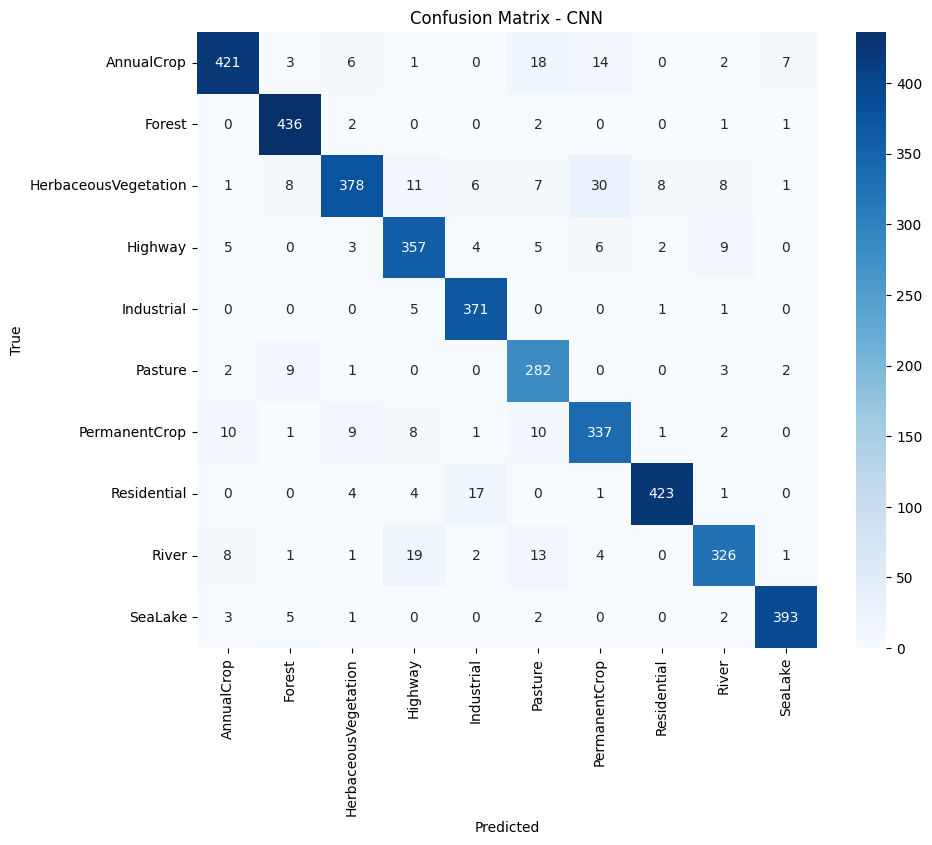
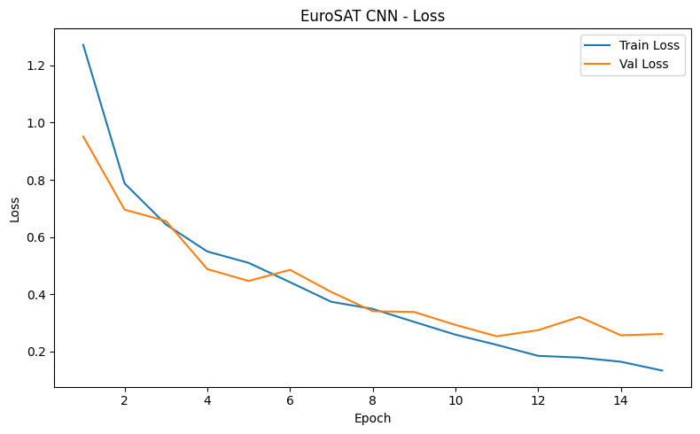
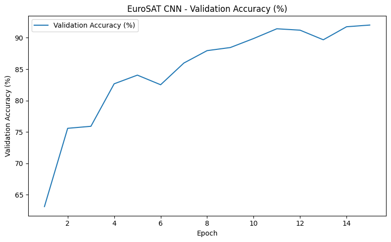
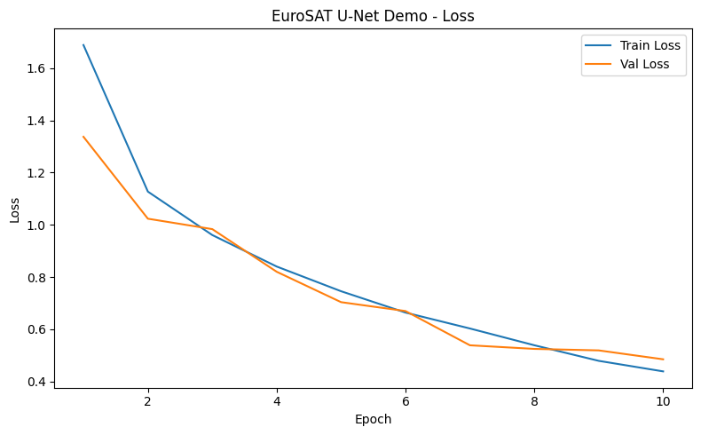
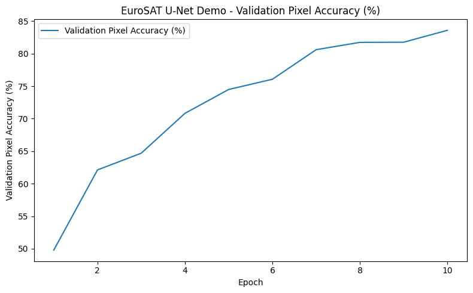

# EuroSAT Satellite Image Analysis with CNN and U-Net (PyTorch)

An individual academic project implemented in Python with PyTorch. It explores satellite-image classification with a convolutional neural network (CNN) and includes a U-Net experiment for demonstrating an encoder-decoder architecture with pseudo-masks.

## Project overview

- Classifies EuroSAT RGB satellite images into 10 land-use / land-cover classes.
- Implements a CNN classifier using `torch.nn`.
- Includes a U-Net encoder-decoder model as a pseudo-segmentation demonstration.
- Trains with PyTorch, Adam and cross-entropy loss.
- Evaluates the CNN with accuracy, macro precision, macro recall, macro F1-score and a confusion matrix.
- Saves model checkpoints, training curves, sample images and prediction visualizations.

## Dataset required (not included)

**The EuroSAT dataset is required to run the training script. It is not included in this GitHub repository.** The dataset is publicly available and can be downloaded from its original sources:

- [EuroSAT on Zenodo](https://zenodo.org/records/7711810)
- [Original EuroSAT repository](https://github.com/phelber/EuroSAT)
- Paper: Helber et al., *EuroSAT: A Novel Dataset and Deep Learning Benchmark for Land Use and Land Cover Classification*, IEEE JSTARS (2019), [DOI: 10.1109/JSTARS.2019.2918242](https://doi.org/10.1109/JSTARS.2019.2918242)

For the current training script, download the **EuroSAT RGB** dataset and extract it into a folder named `EuroSAT` in the repository root. The expected directory layout is:

```text
EuroSAT-CNN-U-Net/
├── EuroSAT/                       # download and extract locally; do not upload to GitHub
│   ├── AnnualCrop/
│   ├── Forest/
│   ├── HerbaceousVegetation/
│   ├── Highway/
│   ├── Industrial/
│   ├── Pasture/
│   ├── PermanentCrop/
│   ├── Residential/
│   ├── River/
│   └── SeaLake/
├── eurosat_cnn_unet.py
└── ...
```

The ten class folders must be direct children of `EuroSAT/`. If the extraction tool creates an extra nested folder, move the class folders up one level.

The script loads images using `torchvision.datasets.ImageFolder` from `./EuroSAT`. It creates its own reproducible 70% / 15% / 15% train-validation-test split using random seed `42`.

## Repository contents

```text
EuroSAT-CNN-U-Net/
├── checkpoints/
│   ├── best_eurosat_cnn.pth
│   └── best_eurosat_unet_demo.pth
├── docs/
│   └── Analiza_imaginilor_satelitare_Cojan_Alin.pdf
├── images/
│   ├── cnn_batch_0.png ... cnn_batch_5.png
│   ├── cnn_confusion_matrix.png
│   ├── EuroSAT_CNN_loss.png
│   ├── EuroSAT_CNN_score.png
│   ├── EuroSAT_U-Net_Demo_loss.png
│   ├── EuroSAT_U-Net_Demo_score.png
│   └── unet_result_0.png ... unet_result_3.png
├── metadata/
│   ├── label_map.json
│   ├── splits_jpg/                 # CSV manifests referring to .jpg images
│   └── splits_tif/                 # CSV manifests referring to .tif images
├── scripts/
│   └── check_dataset.py
├── eurosat_cnn_unet.py
├── logs.txt
├── requirements.txt
└── test.py
```

### About the CSV split files

Two sets of split manifests are included as supplied project files:

- `metadata/splits_jpg/`: train, validation and test CSV files whose paths refer to `.jpg` images.
- `metadata/splits_tif/`: train, validation and test CSV files whose paths refer to `.tif` images.

The class-to-index mapping is stored in `metadata/label_map.json`. These CSV manifests are included for reference and traceability; **the current `eurosat_cnn_unet.py` script does not read them**. It uses `ImageFolder` and creates a new split internally. Ensure that a selected manifest corresponds to the exact dataset variant and file names you use before relying on it.

## Environment setup

Python 3.10 or newer is recommended.

### Windows (PowerShell)

```powershell
py -m venv .venv
.\.venv\Scripts\Activate.ps1
python -m pip install --upgrade pip
```

### Linux / WSL

```bash
python3 -m venv .venv
source .venv/bin/activate
python -m pip install --upgrade pip
```

Install a PyTorch and torchvision build compatible with your operating system and hardware using the [official PyTorch installation selector](https://pytorch.org/get-started/locally/). Then install the remaining dependencies:

```bash
pip install -r requirements.txt
```

The script automatically selects CUDA when `torch.cuda.is_available()` is true; otherwise, it uses the CPU.

## Check the dataset

From the repository root:

```bash
python scripts/check_dataset.py
```

The helper checks the dataset directory and reports detected classes and image counts.

## Run the project

After downloading and extracting EuroSAT RGB into `./EuroSAT/`, run:

```bash
python eurosat_cnn_unet.py
```

The script runs two experiments:

1. **CNN classification** — image-level classification into 10 classes.
2. **U-Net pseudo-segmentation demo** — an educational experiment using pseudo-masks.

Main configuration values are defined near the top of `eurosat_cnn_unet.py`:

- `SEED = 42`
- `IMAGE_SIZE = 64`
- `BATCH_SIZE = 64`
- `NUM_EPOCHS_CNN = 15`
- `NUM_EPOCHS_UNET = 10`
- `LEARNING_RATE = 1e-3`

## Results

### CNN classification

The supplied confusion matrix contains 4,050 test examples. Metrics recalculated from its counts are:

| Metric | Result |
|---|---:|
| Accuracy | **91.95%** |
| Macro precision | 91.70% |
| Macro recall | 92.08% |
| Macro F1-score | 91.79% |







### U-Net pseudo-segmentation demonstration

The supplied experiment reports approximately 83% validation pixel accuracy. Interpret this result carefully: the EuroSAT dataset used here provides image-level class labels, not pixel-level segmentation masks. For the U-Net demonstration, the code creates a pseudo-mask by assigning the image's class label to every pixel. This is **not ground-truth semantic segmentation**, and the reported pixel accuracy should not be treated as a validated segmentation benchmark.





Example predictions are available in `images/unet_result_0.png` through `images/unet_result_3.png`.

## Checkpoints

Both supplied model state dictionaries are included:

- `checkpoints/best_eurosat_cnn.pth` — trained CNN classifier weights.
- `checkpoints/best_eurosat_unet_demo.pth` — U-Net pseudo-segmentation demo weights.

The EuroSAT dataset itself is not included; model checkpoints alone are not sufficient to retrain the models.

## Limitations and possible improvements

- The train/validation/test split in the current script uses `random_split`; it is reproducible with seed `42`, but it is not explicitly stratified by class.
- The U-Net experiment uses pseudo-masks, not human-annotated pixel-level segmentation masks.
- The CNN could be further evaluated using per-class metrics, additional seeds, data augmentation and transfer-learning baselines.
- The supplied `logs.txt` contains only its initial header; it does not preserve the full training history. Running the script creates a fresh log.

## Acknowledgements

Dataset: EuroSAT, created by Patrick Helber, Benjamin Bischke, Andreas Dengel and Damian Borth. Please cite the original paper and dataset record when reusing the data.

This is an individual academic portfolio project. The dataset remains distributed separately by its original authors and is not redistributed in this repository.
